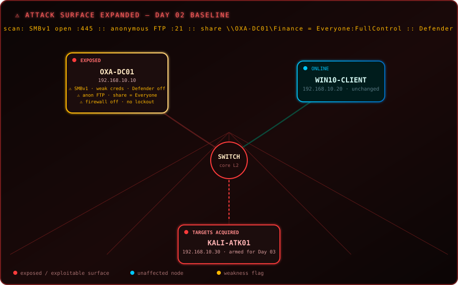

<p align="center">
  
</p>

<p align="center">
  
  
  
  
  
</p>

<h3 align="center">

```
root@oxa:~# ./remove_hardening.sh --target=oxa-dc01 --operator=A-straya --force
```

</h3>

<p align="center"><i>Day 01 built a healthy network. Today we take it apart on purpose.<br>
Every patch, policy and protection we strip here is something Kali gets to find tomorrow.</i></p>

<br>

```diff
- [DROP]   Windows Update ........................... DISABLED
- [DROP]   Windows Defender Firewall ................ DISABLED
- [DROP]   Real-time protection ..................... DISABLED
- [DROP]   Account lockout policy ................... DISABLED
+ [ADD]    SMBv1 (legacy protocol) .................. ENABLED
+ [ADD]    Anonymous FTP ............................. ENABLED
+ [ADD]    \\OXA-DC01\Finance → Everyone:FullControl .. SET
! [ALERT]  j.martin password ......................... WEAK
! [ALERT]  Attack surface ............................ EXPANDED
```

---

## `0x00` — Briefing

**Day 01** gave Company OXA a pulse. **Day 02** gives it a pre-existing condition.
Real networks drift out of hardened state over time — missed patches, a share permission nobody
locked down, a password policy nobody enforced. We're recreating that drift deliberately, in one sitting,
so Day 03's Kali box has a believable, exploitable target instead of a sterile lab machine.

| | |
|---|---|
|  **Target** | OXA-DC01 — `oxa.local` |
|  **Operator** | `A-straya` |
|  **Defenses removed** | Windows Update, Defender, Firewall, account lockout |
|  **Doors opened** | SMBv1, anonymous FTP, open share, weak credentials |
| **Next** | Day 03 — Kali recon, credential attacks, the FTP→IIS chain, Metasploit |

---

## `0x01` — Exposure Map

<p align="center">
  
</p>

<p align="center"><sub>🔴 red = exposed / exploitable surface &nbsp;·&nbsp; 🔵 blue = unaffected node &nbsp;·&nbsp; 🟡 amber = specific weakness flagged</sub></p>

> ⚠️ OXA-DC01 is now measurably less secure than it was yesterday. That's the point — but it means
> this network must stay fully isolated. Never bridge it to anything real.

---

## `0x02` — What Changed (Build Log)

> Full step-by-step with exact commands is in `docs/OXA_Day2_Guide.pdf`.

### Patch level
- [ ] Windows Update service stopped and set to Disabled
- [ ] Group Policy: Configure Automatic Updates → Disabled

### Legacy protocol
- [ ] SMBv1 / CIFS feature enabled (`Enable-WindowsOptionalFeature`)
- [ ] Verified via `Get-SmbServerConfiguration`

### Authentication
- [ ] Default Domain Policy: complexity off, min length lowered, max age = 0
- [ ] Account lockout threshold set to 0 (no lockout)
- [ ] `j.martin`'s password changed to a weak/common value
- [ ] `gpupdate /force` run to apply changes

### Endpoint defense
- [ ] Real-time protection disabled (`Set-MpPreference`)
- [ ] Windows Defender Firewall disabled on all profiles

### Service exposure
- [ ] `\\OXA-DC01\Finance` share permissions opened to Everyone
- [ ] FTP Anonymous Authentication enabled
- [ ] *(optional, recommended)* FTP physical path pointed at `wwwroot` for a real upload→execute chain

### Checkpointing
- [ ] Snapshot `01-pre-hardening-removal` taken before changes
- [ ] Snapshot `02-vulnerable-state` taken after all changes

---

## `0x03` — Realistic Vulnerability Map

| Weakness introduced | What it actually enables on Day 03 |
|---|---|
| SMBv1 re-enabled | Protocol fingerprinting via Nmap/enum4linux. **Not** EternalBlue-exploitable — Server 2019 ships already patched against MS17-010. |
| Weak `j.martin` password + no lockout | Unlimited brute-force via Hydra/CrackMapExec over SMB or RDP → valid credentials. |
| `Everyone: Full Control` on `\Finance` | Direct file read/write — data exposure, possible payload drop point. |
| Anonymous FTP into `wwwroot` | Upload via FTP, execute via IIS over HTTP — a real upload-and-execute RCE chain. |
| Defender / Firewall disabled | Meterpreter payloads execute and phone home without being quarantined. |
| `s.admin` in Domain Admins + found creds | Lateral movement → full domain compromise once any foothold lands. |

> 💡The FTP→IIS chain above is the headline finding for this lab, not EternalBlue — it's a realistic
> pattern seen in actual engagements, and a stronger story for the final report.

---

## `0x04` — Roadmap

| Day | Codename | Status |
|:---:|---|---|
| 01 | `BUILD` |  Done — AD, DNS, DHCP, IIS, SMB, FTP, domain-joined client |
| **02** | `HARDEN⁻¹` |  Done — patches frozen, Defender/Firewall down, weak creds planted, services over-exposed |
| 03 | `BREACH` | Next — Nmap recon → credential attacks → FTP/IIS chain → Metasploit → report |

---

<p align="center">
<sub>🔴🟡🔵 Internal lab repo · Company OXA is a fictional pentest/hardening training target · Not a real organization<br>
Maintained by <b>A-straya</b></sub>
</p>
